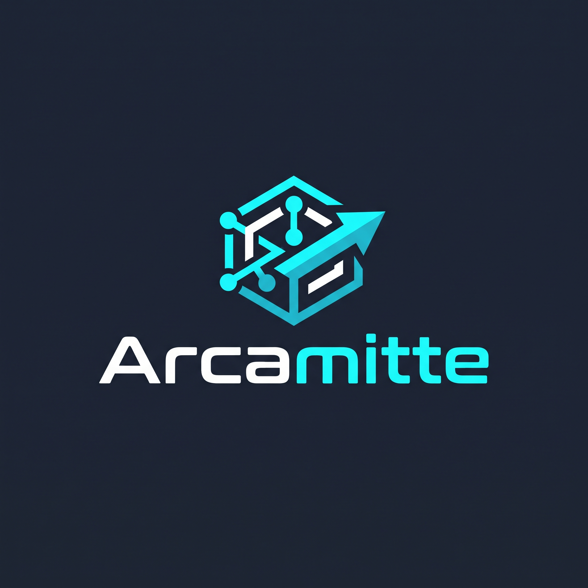
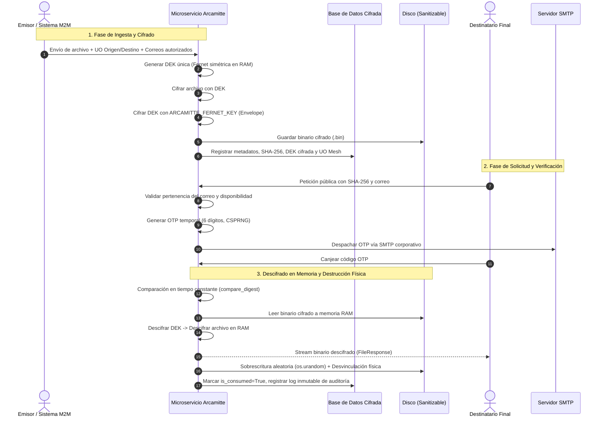

# Arcamitte — Microservicio Criptográfico de Custodia y Entrega Desatendida

<p align="center">
  
</p>

<p align="center">
  <strong>Plataforma Segura de Custodia Efímera de Archivos, Cifrado de Sobre, Malla Departamental y Destrucción Física (NIST SP 800-88 & OWASP Top 10)</strong>
</p>

<p align="center">
  
  
  
  
  
  
</p>

---

## 1. Visión General del Sistema

**Arcamitte** es un microservicio autónomo y de alta seguridad diseñado para la **custodia criptográfica y entrega desatendida de documentos confidenciales**. Elimina de raíz la necesidad de contraseñas humanas legibles, transportes inseguros de binarios y almacenamiento indefinido de datos sensibles.

### Principios Fundamentales de Seguridad:
1. **Entrega Referenciada por Hash SHA-256:** El cliente o sistema integrador nunca envía el documento original por canales inseguros para solicitarlo; únicamente referencia su identificador criptográfico unívoco SHA-256.
2. **Cero Contraseñas Humanas (Zero-Knowledge):** No existen contraseñas memorizables. Cada documento se cifra con una clave simétrica efímera única (DEK) generada en memoria RAM y protegida bajo cifrado de sobre (Envelope Encryption) con la clave maestra de servidor `ARCAMITTE_FERNET_KEY`.
3. **Malla Departamental Aislada (UO Mesh):** Soporte multi-entidad mediante Unidades Organizativas (UO). Los documentos viajan cifrados de una UO emisora a una UO receptora con segregación estricta de privilegios (Operador vs. Auditor).
4. **Verificación Desatendida con OTP Efímero:** El destinatario legítimo solicita el archivo mediante su correo corporativo previamente autorizado y recibe un código OTP de 6 dígitos con caducidad estricta (15 min) y límite de intentos (máx. 3).
5. **Destrucción Segura Física (*Burn-After-Read* & Sanitización):** Al completarse el consumo (o alcanzarse la fecha de caducidad), el binario cifrado en disco es sobrescrito con bytes aleatorios criptográficos (`os.urandom`) antes de ser eliminado del sistema de archivos, garantizando cumplimiento **NIST SP 800-88**.
6. **Tokens M2M de Conocimiento Cero:** La API de integración utiliza credenciales de máquina con prefijo `arca_live_...`. Solo se persiste el hash SHA-256 en base de datos.
7. **Protección Contra Canales Laterales (Anti-Timing Attacks):** Los intentos de enumeración contra hashes inexistentes ejecutan retardos criptográficos sintéticos (PBKDF2) idénticos al cálculo de verificación real para mitigar ataques de temporización (CWE-208).

---

## 2. Arquitectura de Cifrado y Flujo de Vida



---

## 3. Puntos de Entrada e Interfaces

Arcamitte proporciona tres interfaces diseñadas para distintos propósitos operativos:

| Interfaz | Ruta | Descripción |
| :--- | :--- | :--- |
| **Bespoke Cyber-Ops Dashboard** | `/dashboard/` | Panel de control moderno en tema oscuro (Bootstrap 5 nativo, sin dependencias de terceros), estadísticas de custodia, subida de documentos, gestión de UOs, auditoría y tokens de API. |
| **Django Admin Clásico** | `/admin/` | Panel administrativo oficial con validaciones avanzadas, importación masiva JSON, inspección de hashes e inmutabilidad garantizada. |
| **Portal Público de Canje** | `/arcamitte/solicitar/` | Pasarela ligera y adaptada a móviles para que los destinatarios soliciten su OTP e introduzcan su código para descargar el archivo. |
| **Machine-to-Machine REST API** | `/api/v1/` | Endpoints seguros para automatizaciones con autenticación por encabezado `X-API-Key: arca_live_...`. |

---

## 4. Requisitos y Dependencias

- **Python:** 3.12, 3.13 o 3.14
- **Gestor de Paquetes:** [Poetry](https://python-poetry.org/) (o `pip`)
- **Librerías Criptográficas y Web:**
  - `django >= 5.1`
  - `djangorestframework >= 3.15`
  - `cryptography >= 43.0`
  - `python-magic >= 0.4.27`
  - `pillow >= 10.4.0`

---

## 5. Instalación y Configuración Rápida

### Paso 1: Clonar el Repositorio
```bash
git clone https://github.com/jrubioh1/arcamitte.git
cd arcamitte
```

### Paso 2: Instalar Dependencias con Poetry
```bash
poetry install
```

### Paso 3: Configurar `arcamitte.ini`
Copie la plantilla de configuración e inicialice las variables requeridas:
```bash
cp arcamitte.ini.template arcamitte.ini
```

Genere una clave simétrica Fernet de 32 bytes en formato url-safe base64:
```bash
poetry run python -c "from cryptography.fernet import Fernet; print(Fernet.generate_key().decode())"
```
Pegue la clave generada en la sección `[security]` de `arcamitte.ini`:
```ini
[security]
fernet_key = TU_CLAVE_GENERADA_AQUI=
timing_pbkdf2_iterations = 20000
max_file_size = 52428800
```

### Paso 4: Inicializar la Base de Datos y el Entorno Staging
El microservicio incluye un comando idempotente de arranque que crea la base de datos, aplica migraciones, provisiona la malla inicial de UOs (Seguridad, RRHH, Finanzas, Legal), crea el usuario superadministrador y prepara documentos de prueba:

```bash
poetry run python manage.py setup_staging --clean
```
> **Credenciales de Staging creadas:**
> - **Superadmin:** `admin` / `AdminPass123!`
> - **Operador UO:** `operador_seguridad` / `StagingPass123!`
> - **Auditor UO:** `auditor_seguridad` / `StagingPass123!`

### Paso 5: Ejecutar el Servidor de Desarrollo
```bash
poetry run python manage.py runserver 0.0.0.0:8000
```

Acceda a:
- **Dashboard Operativo:** [http://127.0.0.1:8000/dashboard/](http://127.0.0.1:8000/dashboard/)
- **Portal Público:** [http://127.0.0.1:8000/arcamitte/solicitar/](http://127.0.0.1:8000/arcamitte/solicitar/)
- **Django Admin:** [http://127.0.0.1:8000/admin/](http://127.0.0.1:8000/admin/)

---

## 6. Configuración `arcamitte.ini`

El microservicio utiliza un archivo INI como única fuente de verdad técnica:

```ini
[django]
secret_key = clave-secreta-para-sesiones-y-csrf
debug = true
allowed_hosts = 127.0.0.1,localhost

[security]
fernet_key = ClaveFernetGeneradaDe32BytesUrlSafe=
max_file_size = 52428800
timing_pbkdf2_iterations = 20000

[email]
backend = django.core.mail.backends.console.EmailBackend
host = localhost
port = 25
default_from_email = no-reply@arcamitte.local
async_email = true
email_max_workers = 8

[throttling]
web_request_limit_per_minute = 15
api_access_request_rate = 15/minute
api_access_consume_rate = 30/minute
```

---

## 7. M2M API Gate (Integración con Sistemas Externos)

Los sistemas corporativos (CRM, ERP, Gestores Documentales) pueden automatizar la subida y custodia de archivos mediante la API REST v1.

### Generación de Token
Genere un token desde el Dashboard (`/dashboard/api-tokens/`) o mediante el comando de administración. El token generado tendrá el formato:
`arca_live_XXXXXXXXXXXXXXXXXXXXXXXXXXXXXXXXXXXXXXXXXXX`

### Ejemplo de Subida de Documento
La aplicación integradora externa únicamente necesita enviar el archivo y los correos autorizados:
```bash
curl -X POST http://127.0.0.1:8000/api/v1/documents/ \
  -H "X-API-Key: arca_live_SU_TOKEN_AQUI" \
  -F "original_file=@contrato_confidencial.pdf" \
  -F "allowed_emails=destinatario@empresa.com"
```

Respuesta JSON:
```json
{
  "id": "e5b8d28a-7cb2-4a0b-9df6-2be5188f6194",
  "status": "created",
  "file_hash": "c5f590b2b80041d8e1f5f3e9c68c34fba3f5e5529f7cf7c65d63f47e09961dbf",
  "original_filename": "contrato_confidencial.pdf",
  "burn_policy": "FIRST_ACCESS",
  "expires_at": "2026-11-07T12:00:00Z"
}
```

> **Nota sobre UOs:** Las Unidades Organizativas (`origin_uo`, `target_uo`) son 100% opcionales. La aplicación externa no necesita saber nada de departamentos si no los utiliza; Arcamitte se encarga de la custodia criptográfica y la entrega segura de forma totalmente autónoma.

### Consultar Estado Criptográfico (Sin exponer contenido)
```bash
curl -X GET http://127.0.0.1:8000/api/v1/documents/c5f590b2b80041d8e1f5f3e9c68c34fba3f5e5529f7cf7c65d63f47e09961dbf/status/ \
  -H "X-API-Key: arca_live_SU_TOKEN_AQUI"
```

---

## 8. Verificación de Seguridad y Pruebas Unitarias

La suite de pruebas incluye **109 tests automatizados** con verificación rigurosa de controles de seguridad, validación de formatos mágicos, sanitización NIST SP 800-88, aislamiento de mallas UO, ciclo de vida de usuarios/contraseñas y defensas anti-fuerza bruta:

```bash
poetry run pytest -v
```

Resultado verificado:
```text
============================= 109 passed in 26.32s =============================
```

### Controles de Seguridad Verificados (SAST & SCA)
El código y las dependencias han sido sometidos a auditoría de seguridad exhaustiva:
- **SCA (pip-audit):** 0 vulnerabilidades conocidas en librerías en tiempo de ejecución (`cryptography >= 50.0.2`, `djangorestframework >= 3.18.3`).
- **SAST Python (Bandit):** 0 vulnerabilidades de severidad Alta o Media en más de 10.000 líneas de código. Eliminación del 100% de llamadas a `mark_safe` en favor de `format_html` sanitizado.
- **SAST OWASP (Semgrep OSS):** 0 hallazgos bloqueantes sobre 456 reglas activas (OWASP Top 10, CWE, inyecciones y CSRF).
- **Subresource Integrity (SRI):** Atributos `integrity="sha384-..."` y `crossorigin="anonymous"` obligatorios en todos los recursos externos CDN.
- **Hardening de Cabeceras y Cookies:** `SESSION_COOKIE_SECURE`, `CSRF_COOKIE_SECURE`, `LANGUAGE_COOKIE_SECURE`, `SECURE_CONTENT_TYPE_NOSNIFF`, `X_FRAME_OPTIONS = "DENY"` y HSTS activo en producción (`DEBUG=False`).

---

## 9. Cumplimiento de Estándares de Seguridad

- **NIST SP 800-88 Rev. 1 (Media Sanitization):** Sobrescritura aleatoria de almacenamiento físico previa desvinculación de inodo.
- **NIST SP 800-53 Rev. 5:**
  - `SC-13 / SC-28`: Cifrado criptográfico fuerte en reposo y en tránsito.
  - `AC-3 / AC-6`: Menor privilegio y aislamiento departamental por UO.
  - `AU-2 / AU-9`: Registro inmutable de eventos de acceso y auditoría forense.
- **OWASP API Security Top 10 (2023):**
  - `API1:2023 (BOLA)`: Aislamiento estricto de documentos por pertenencia de UO y usuario.
  - `API2:2023 (Broken Auth)`: Tokens de conocimiento cero y OTPs efímeros con caducidad forzada.
  - `API4:2023 (Unrestricted Resource Consumption)`: Limitación de tasa (throttling) en peticiones públicas y de API.
  - `API8:2023 (Security Misconfiguration)`: Verificación en el arranque de la clave de producción `ARCAMITTE_FERNET_KEY`.

---

## 10. Documentación Técnica Detallada

Para consultar la documentación completa de cada subsistema:
- [Guía de Arquitectura Criptográfica](docs/ARCHITECTURE.md)
- [Referencia Completa de la API REST](docs/API_REFERENCE.md)
- [Manual de Administración y Operaciones](docs/ADMIN_GUIDE.md)
- [Controles y Modelo de Seguridad](docs/SECURITY.md)

---

## Licencia

Distribuido bajo licencia GNU General Public License v3.0. Consulte `LICENSE` para más información.
Arcamitte Project &copy; 2026.
