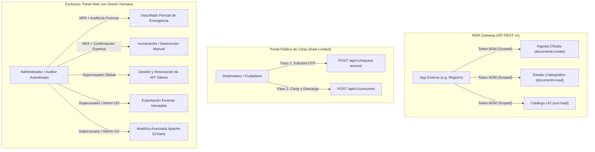

# Referencia y Arquitectura de la API REST de Arcamitte (v1)

Esta especificación describe los contratos de comunicación, autenticación, alcances de seguridad y especificación técnica de endpoints para la integración de sistemas externos (e.g., *App de Registro*, aplicaciones ministeriales o ERP corporativo) con **Arcamitte**.

---

## 1. Principio Arquitectónico: Reducción de Superficie de Ataque y Separación de Responsabilidades

Arcamitte aplica el principio de **Mínimo Privilegio (Least Privilege)** y **Defensa en Profundidad (Defense in Depth)** en su pasarela de interoperabilidad:



### Reglas Innegociables de Seguridad en la API:
1. **La API es puramente una pasarela operativa de ingesta y consulta:**  
   Un token de API **NUNCA** puede eliminar, destruir, reactivar ni descifrar pericialmente documentos en custodia.
2. **Eliminación de endpoints de alto impacto:**  
   Acciones críticas como `terminate` (incineración manual de asientos), `audit-decrypt` (descifrado pericial legal), `reactivate` o `audit-export` **no existen en la API** (devuelven `404 NOT FOUND`). Dichas operaciones se reservan **exclusivamente** para usuarios administradores humanos autenticados a través de la interfaz web con auditoría forense inmutable.
3. **Imposibilidad de escalada por tokens comprometidos:**  
   Incluso si la base de datos o el almacenamiento de una aplicación externa consumidora de la API fuese vulnerada, un atacante con el token M2M solo podrá consultar el estado de documentos o subir nuevos trámites cifrados; jamás podrá realizar enumeración masiva no autorizada, borrado de asientos ni robo de documentos confidenciales.

---

## 2. Esquema de Autenticación y Encabezados

Los endpoints internos de máquina (`/api/v1/...`) requieren autenticación mediante **Tokens de Máquina (API Keys)** generados por un Superusuario desde el panel web.

### Encabezados Admitidos
Puede remitir su clave mediante cualquiera de los siguientes dos encabezados estándar:
- `X-API-Key: arca_live_...`
- `Authorization: Bearer arca_live_...`

> [!NOTE]
> Las claves de producción comienzan con el prefijo `arca_live_` y contienen 32 bytes de entropía generados por un CSPRNG criptográficamente seguro (`secrets.token_hex(32)`). En la base de datos de Arcamitte se almacena únicamente el hash SHA-256 del token para evitar exposición ante accesos indebidos a la BD.

### Control de Ámbitos (Scopes)
Al generar un token en el Dashboard de Arcamitte, se le asigna de manera estricta y granular uno o varios de los siguientes 3 alcances:

| Ámbito (Scope) | Descripción | Endpoints Autorizados |
| :--- | :--- | :--- |
| `documents:create` | Subida e ingesta de documentos confidenciales para cifrado inmediato. | `POST /api/v1/documents/` |
| `documents:read` | Consulta del estado criptográfico y trazabilidad básica de un asiento. | `GET /api/v1/documents/{file_hash}/status/` |
| `uos:read` | Consulta del catálogo de Unidades Organizativas internas y sus buzones. | `GET /api/v1/uos/`, `GET /api/v1/uos/{id}/`, `GET /api/v1/uos/{id}/members/` |

---

## 3. Límites de Tasa (Rate Limiting y Throttling)

Para salvaguardar la disponibilidad del servicio contra ataques de denegación de servicio (DoS) y fuerza bruta contra códigos OTP:
- **Endpoints Públicos de Solicitud OTP:** Máximo 15 solicitudes por minuto por IP (`15/min`).
- **Endpoints Públicos de Canje OTP:** Máximo 30 intentos por minuto por IP (`30/min`).
- Si se excede el límite, el microservicio responde con código HTTP `429 Too Many Requests`.

---

## 4. Endpoints de la API v1

### 4.1 Subir y Cifrar Documento
Permite a un sistema autorizado ingerir un archivo confidencial para su custodia y entrega cifrada.

- **Método:** `POST`
- **Ruta:** `/api/v1/documents/`
- **Ámbito Requerido:** `documents:create`
- **Content-Type:** `multipart/form-data`

> [!TIP]
> **Diseño Desacoplado:** La aplicación integradora externa **NO necesita especificar Unidades Organizativas (UO)** obligatoriamente. Solo requiere enviar el archivo y los correos autorizados. La asignación de UO es opcional dentro de Arcamitte.

#### Parámetros del Formulario
| Parámetro | Tipo | Requerido | Descripción |
| :--- | :--- | :--- | :--- |
| `original_file` | Binario | **Sí** | Archivo en formato permitido (PDF, DOCX, ODT, XLSX, JPG, PNG). Máx. 50 MB. |
| `allowed_emails` | Cadena / JSON | **Sí** | Correo o lista de correos autorizados para el canje con OTP (ej. `["destinatario@empresa.com"]` o `correo@empresa.com`). |
| `description` | Cadena | No | Resumen u objeto informativo del trámite confidencial. |
| `burn_policy` | Cadena | No | Política de destrucción: `FIRST_ACCESS` (por defecto) o `ALL_RECIPIENTS`. |
| `expires_at` | ISO-8601 | No | Fecha/hora límite de disponibilidad. Por defecto: +14 días. |
| `origin_uo` | Cadena / Int | No (Opcional) | Alias o código de la UO interna emisora si se desea etiquetar en la malla de Arcamitte. |
| `target_uo` | Cadena / Int | No (Opcional) | Alias o código de la UO interna receptora (opcional). |

#### Ejemplo de Petición cURL
```bash
curl -X POST https://arcamitte.empresa.local/api/v1/documents/ \
  -H "X-API-Key: arca_live_9d8f3a8b4c2e1f0e9d8c7b6a5f4e3d2c1b0a" \
  -F "original_file=@expediente_auditoria.pdf" \
  -F "allowed_emails=director@empresa.com" \
  -F "description=Expediente Confidencial de Auditoría Q3"
```

#### Respuesta Exitosa (201 Created)
```json
{
  "file_hash": "c5f590b2b80041d8e1f5f3e9c68c34fba3f5e5529f7cf7c65d63f47e09961dbf",
  "original_filename": "expediente_auditoria.pdf",
  "description": "Expediente Confidencial de Auditoría Q3",
  "origin_uo": 1001,
  "target_uo": 1002,
  "is_consumed": false,
  "burn_policy": "FIRST_ACCESS",
  "authorized_emails": [
    "director@empresa.com"
  ],
  "expires_at": "2026-11-07T12:00:00Z",
  "created_at": "2026-10-24T12:00:00Z"
}
```

---

### 4.2 Consultar Estado Criptográfico de un Documento
Permite a los sistemas clientes verificar si un documento sigue en custodia activa o ha sido consumido/destruido, sin exponer su contenido ni descargar el binario.

- **Método:** `GET`
- **Ruta:** `/api/v1/documents/{file_hash}/status/`
- **Ámbito Requerido:** `documents:read`

#### Ejemplo de Petición
```bash
curl -X GET https://arcamitte.empresa.local/api/v1/documents/c5f590b2b80041d8e1f5f3e9c68c34fba3f5e5529f7cf7c65d63f47e09961dbf/status/ \
  -H "X-API-Key: arca_live_9d8f3a8b4c2e1f0e9d8c7b6a5f4e3d2c1b0a"
```

#### Respuesta Exitosa (200 OK)
```json
{
  "file_hash": "c5f590b2b80041d8e1f5f3e9c68c34fba3f5e5529f7cf7c65d63f47e09961dbf",
  "original_filename": "expediente_auditoria.pdf",
  "is_consumed": false,
  "is_expired": false,
  "burn_policy": "FIRST_ACCESS",
  "recipients_count": 1,
  "consumed_by_count": 0,
  "created_at": "2026-10-24T12:00:00Z",
  "expires_at": "2026-11-07T12:00:00Z"
}
```

---

### 4.3 Consultar Catálogo de Unidades Organizativas (UO)
Permite a sistemas externos sincronizar los departamentos u oficinas disponibles para el enrutamiento de trámites.

- **Método:** `GET`
- **Rutas:**
  - Listado: `GET /api/v1/uos/`
  - Detalle por ID o Alias: `GET /api/v1/uos/{identifier}/`
  - Miembros autorizados: `GET /api/v1/uos/{identifier}/members/`
- **Ámbito Requerido:** `uos:read`

#### Ejemplo de Respuesta (200 OK)
```json
[
  {
    "numeric_code": 1001,
    "alias": "RRHH",
    "name": "Recursos Humanos y Selección",
    "email": "rrhh@empresa.local",
    "is_active": true
  },
  {
    "numeric_code": 1002,
    "alias": "LEGAL",
    "name": "Asesoría Jurídica y Cumplimiento",
    "email": "legal@empresa.local",
    "is_active": true
  }
]
```

---

## 5. Endpoints Públicos de Canje (Integración de Portales Ciudadanos o Externos)

Para portales de autoservicio o clientes ligeros que no posean sesión interactiva de administración:

### 5.1 Solicitar Código OTP
Despacha un código de verificación criptográfico al buzón del destinatario legítimo.

- **Método:** `POST`
- **Ruta:** `/api/v1/request-access/`
- **Autenticación:** Pública (protegida por Rate Limiting `15/min`).
- **Content-Type:** `application/json`

#### Cuerpo de la Petición
```json
{
  "file_hash": "c5f590b2b80041d8e1f5f3e9c68c34fba3f5e5529f7cf7c65d63f47e09961dbf",
  "email": "director@empresa.com"
}
```

#### Respuesta (200 OK)
```json
{
  "status": "success",
  "message": "Si los datos indicados corresponden a un documento disponible y una dirección de correo autorizada, recibirá en breve un código de verificación en su buzón."
}
```

---

### 5.2 Canjear OTP y Descargar Archivo Descifrado (Burn-After-Read)
Valida el código temporal e inicia el stream directo del binario descifrado en memoria.

- **Método:** `POST`
- **Ruta:** `/api/v1/consume/`
- **Autenticación:** Pública (protegida por Rate Limiting `30/min`).
- **Content-Type:** `application/json`

#### Cuerpo de la Petición
```json
{
  "file_hash": "c5f590b2b80041d8e1f5f3e9c68c34fba3f5e5529f7cf7c65d63f47e09961dbf",
  "email": "director@empresa.com",
  "otp_code": "489201"
}
```

#### Respuesta Exitosa (200 OK)
- **Headers:**
  - `Content-Type: application/pdf` (o MIME type original)
  - `Content-Disposition: attachment; filename="expediente_auditoria.pdf"`
- **Body:** Flujo binario descifrado al vuelo.
- **Efecto Inmediato (BAR):** El binario en el servidor es destruido físicamente mediante sobrescritura criptográfica aleatoria (`os.urandom`) y truncado antes de ser desvinculado del sistema de archivos.

---

## 6. Documentación Interactiva OpenAPI 3 / Swagger

Arcamitte expone su esquema normalizado OpenAPI 3 validado mediante `drf-spectacular`:

- **Esquema YAML/JSON OpenAPI:** `/api/schema/`
- **Documentación Interactiva Swagger UI:** `/api/docs/`
- **Documentación Interactiva Redoc:** `/api/redoc/`
