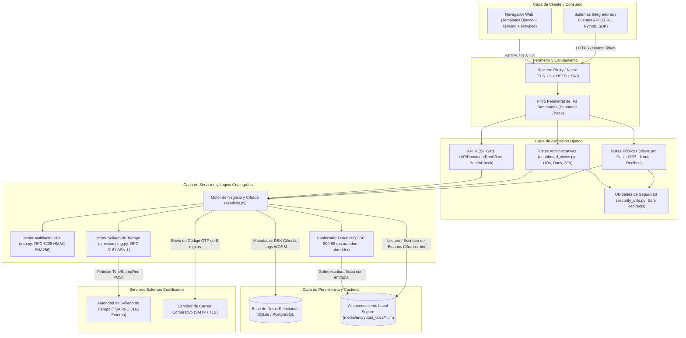
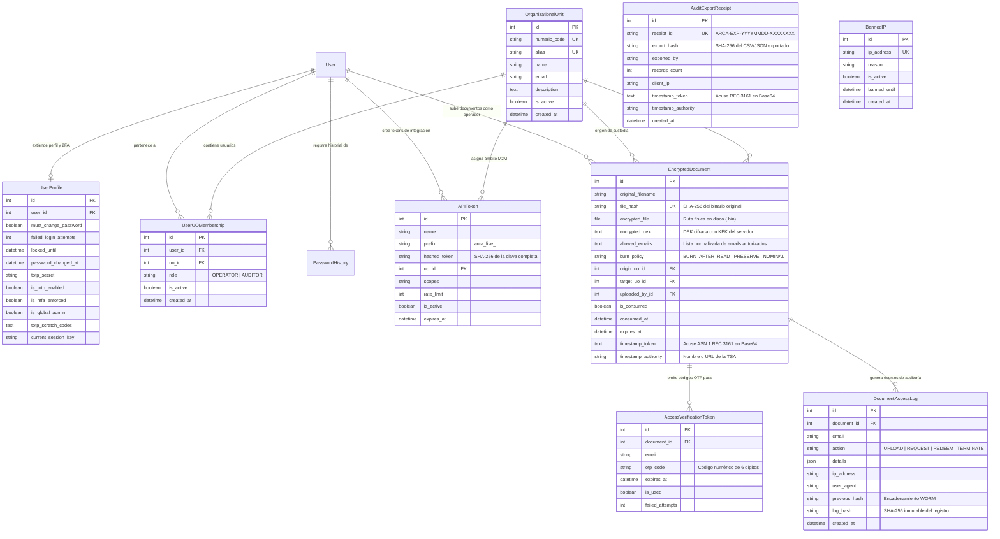
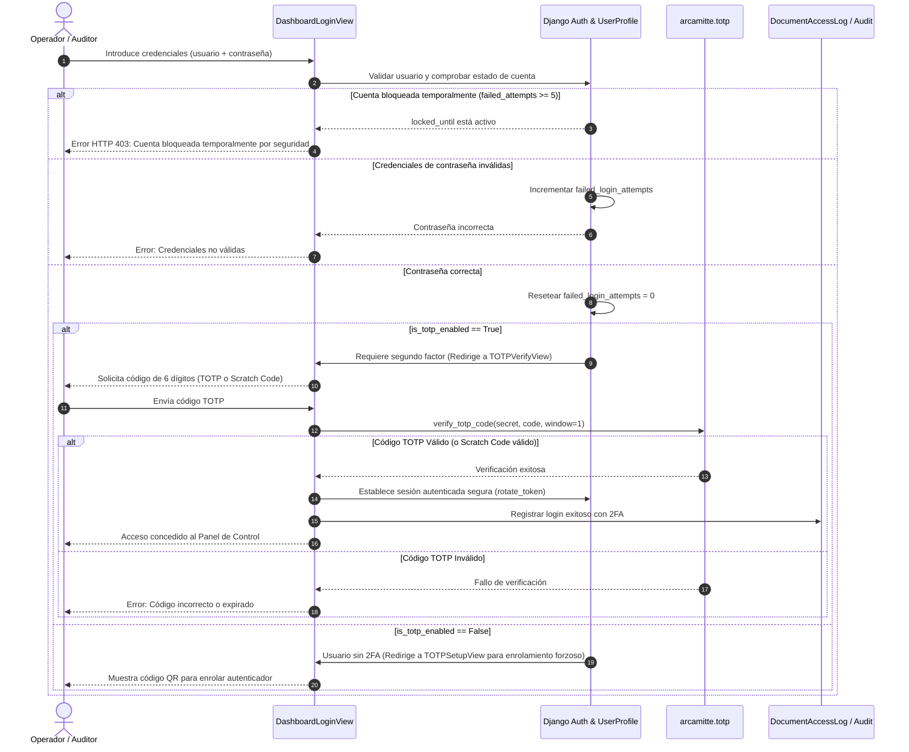
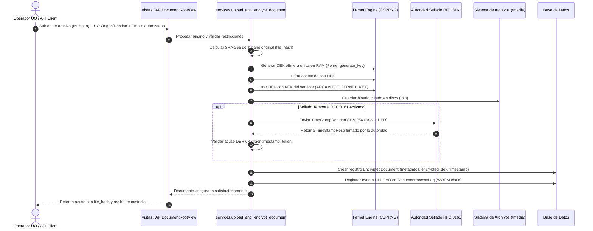
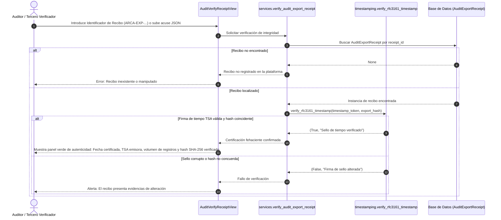

# Documentación Técnica y de Arquitectura — Arcamitte MVP v1.0

<p align="center">
  
</p>

<p align="center">
  <strong>Microservicio Criptográfico de Custodia Efímera, Cifrado de Sobre, Malla Departamental y Sellado Cualificado de Tiempo</strong><br>
  <em>Cumplimiento estricto con NIST SP 800-88 Rev. 1, RFC 3161, RFC 6238, OWASP Top 10 y ENS (Nivel Alto)</em>
</p>

---

## 1. Resumen Ejecutivo y Alcance del MVP

### 1.1 Propósito del Sistema y Caso de Negocio
Las organizaciones actuales intercambian diariamente miles de documentos confidenciales (nóminas, contratos, auditorías forenses, historiales médicos y reportes de seguridad) utilizando canales no seguros como correos electrónicos corporativos, servicios comerciales de compartición en la nube o soportes físicos extraíbles (pendrives). Esta práctica expone a las organizaciones a filtraciones masivas de datos, ataques de hombre en el medio (MitM) y persistencia residual indefinida de información en discos duros.

**Arcamitte** (*del latín clásico Arca + Mittere: "Enviar el arca" o "Despachar el secreto"*) surge como una solución tecnológica soberana: un microservicio autónomo y seguro que garantiza la **custodia efímera y entrega desatendida de documentos confidenciales**. En Arcamitte, el servidor jamás tiene acceso al documento en claro en disco; el contenido viaja sellado criptográficamente y se destruye físicamente tras su consumo mediante algoritmos conformes a estándares militares y de inteligencia.

#### Propuesta de Valor:
1. **Cero persistencia de datos legibles:** Todo documento se cifra en memoria RAM antes de tocar el medio físico.
2. **Cero contraseñas humanas compartidas:** Se erradica el intercambio inseguro de contraseñas memorizables entre personas. La autenticación se realiza mediante tokens efímeros OTP y códigos de tiempo.
3. **Destrucción Física Certificada (*Burn-After-Read*):** Los archivos consumidos o expirados son sobrescritos con entropía criptográfica antes de liberar sus inodos (NIST SP 800-88).
4. **Fehaciencia Temporal e Inmutabilidad:** Integración de sellado de tiempo cualificado según el estándar RFC 3161 y cadena de auditoría forense WORM (*Write Once, Read Many*).

### 1.2 Alcance Funcional del MVP (v1.0)
La primera versión operativa (Minimum Viable Product) de Arcamitte incluye las siguientes capacidades completamente implementadas y verificadas:

| Subsistema / Módulo | Funcionalidades Incluidas en el MVP |
| :--- | :--- |
| **Cifrado de Sobre (*Envelope Encryption*)** | Cifrado simétrico de binarios con clave de datos efímera (DEK) generada en RAM por archivo (Fernet / AES-128-CBC + HMAC-SHA256). Cifrado de la DEK con la clave maestra de servidor (KEK). |
| **Políticas de Consumo y Borrado Seguro** | Tres modalidades de entrega: *Burn-After-Read* (destrucción inmediata tras el primer canje), *Preserve-Until-Expiry* (múltiples descargas autorizadas hasta fecha límite) y *Nominal Multi-Recipient* (control nominal por destinatario). Sanitización de disco con `os.urandom` previa a `unlink`. |
| **Portal Público de Canje Desatendido** | Interfaz pública accesible por hash SHA-256. Proceso de dos pasos: solicitud de acceso mediante correo previamente autorizado y verificación mediante código OTP de 6 dígitos con ventana de caducidad (15 min) y límite de fallos (máx. 3 intentos). |
| **Gobernanza de Identidades y 2FA/TOTP** | Autenticación administrativa nativa de dos factores basada en tiempo (RFC 6238 / RFC 4226) con algoritmo HMAC-SHA256, códigos de rescate hash SHA-256, renderizado SVG nativo de códigos QR y reseteo administrativo auditado. |
| **Malla Departamental (*UO Mesh*)** | Segmentación multi-inquilino de documentos por Unidad Organizativa emisora y receptora. Roles estrictos: `OPERATOR` (gestión y carga) y `AUDITOR` (solo lectura, métricas y trazabilidad). Herramienta de importación masiva de estructuras JSON. |
| **Sellado de Tiempo Cualificado (RFC 3161)** | Implementación pura en Python de ASN.1 DER para generar `TimeStampReq` y validar `TimeStampResp` frente a Autoridades de Sellado de Tiempo (TSA) acreditadas (DigiCert, FNMT, etc.), anclando la prueba temporal en documentos y recibos. |
| **Auditoría Forense y Recibos Criptográficos** | Registro inmutable encadenado por hash SHA-256 (`DocumentAccessLog`). Exportación certificada de evidencias en formato CSV/JSON firmada mediante recibos de auditoría sellados temporalmente (`AuditExportReceipt`). Portal público de verificación de autenticidad de recibos. |
| **API REST v1 de Integración M2M** | Endpoints de subida, consulta y salud para integración máquina a máquina protegidos por Bearer Tokens de alta entropía con persistencia en hash SHA-256 de conocimiento cero (`APIToken`). |
| **Firewall de Aplicación y Bloqueo de IPs** | Registro de direcciones IP bloqueadas temporal o indefinidamente (`BannedIP`), con vista administrativa dedicada y corte perimetral de peticiones maliciosas. |
| **Internacionalización y UI Moderna** | Soporte bilingüe completo (Español / Inglés) con catálogos compilados Gettext (.po/.mo) al 100%. Interfaz moderna basada en Tailwind CSS, Flowbite y Tom Select sin dependencias obsoletas. |

### 1.3 Límites Actuales (Fuera de Alcance en MVP)
Las siguientes capacidades se han dejado deliberadamente fuera del alcance del MVP para iteraciones futuras:
- **Almacenamiento distribuido en la nube:** El MVP opera sobre almacenamiento local protegido. La integración nativa con buckets AWS S3 / Google Cloud Storage con cifrado KMS se incorporará en la versión 2.0.
- **Federación de Identidades Corporativas (SSO):** Autenticación delegada mediante SAML 2.0 / OpenID Connect (Azure AD / Okta / Keycloak).
- **Firma Electrónica Avanzada de Usuario (PAdES/XAdES):** El MVP asegura la fehaciencia temporal de custodia y auditoría; la firma documental con certificados cualificados personales del usuario final (DNIe / tarjeta criptográfica) no forma parte del microservicio.
- **Cifrado Asimétrico en Cliente (E2EE con WebCrypto / PGP):** En el MVP, el cliente delega el cifrado de sobre al backend a través de un canal seguro TLS 1.3.

---

## 2. Arquitectura del Sistema y Diagramas Técnicos

### 2.1 Diagrama de Arquitectura Global del Sistema



---

### 2.2 Diagrama Entidad-Relación (ER)

El siguiente diagrama detalla el modelo de datos relacional implementado en Arcamitte:



---

### 2.3 Diagramas de Secuencia de Flujos Clave

#### Flujo 1: Autenticación Administrativa con 2FA (TOTP) y Bloqueo de Intentos



---

#### Flujo 2: Ingesta, Cifrado de Sobre (*Envelope Encryption*) y Sellado RFC 3161



---

#### Flujo 3: Verificación de Recibos de Auditoría (*Audit Verify Receipt*)



---

## 3. Modelo de Seguridad y Cumplimiento

### 3.1 Criptografía y Gestión de Secretos
Arcamitte adopta un enfoque defensivo alineado con el **NIST SP 800-53** y el **Esquema Nacional de Seguridad (ENS)** en su nivel Alto:
- **Cifrado en Reposo (Cifrado de Sobre):** Ningún archivo en claro se almacena jamás en el sistema de almacenamiento. Cada archivo recibe una clave de cifrado de datos (DEK) independiente de 256 bits, generada en memoria con `Fernet.generate_key()`. La DEK es a su vez cifrada con la clave de sobre del servidor (`ARCAMITTE_FERNET_KEY`) y almacenada en base de datos.
- **Generación Segura de Entropía:** Prohibición estricta de generadores pseudoaleatorios deterministas (`random.random()`). Todas las sales criptográficas, tokens y nonces se generan utilizando `secrets.token_bytes(16)` o `os.urandom()`.
- **Funciones de Hashing:** El cálculo de huellas digitales de documentos, recibos de auditoría y tokens API utiliza exclusivamente **SHA-256** (NIST FIPS 180-4). Se han purgado y reemplazado todos los usos de funciones obsoletas o vulnerables (MD5, SHA-1) en el repositorio.
- **Mitigación de Ataques de Temporización (CWE-208):** Durante la solicitud de acceso a documentos inexistentes o con correos no autorizados, el servicio ejecuta cómputos sintéticos de PBKDF2 (`_simulate_timing_mitigation_hash`) con sal aleatoria para garantizar que el tiempo de respuesta sea constante, impidiendo a un atacante inferir si un archivo o correo existe en la base de datos.

### 3.2 Gobernanza de Identidades y Autenticación Multifactor (2FA)
- **Implementación Pura de TOTP (RFC 6238 / RFC 4226):** El módulo [`arcamitte/totp.py`](file:///home/jorge/GitHubRepositories/Arcamitte/arcamitte/totp.py) implementa la generación y validación de contraseñas de un solo uso por tiempo en Python puro, calculando HMAC-SHA256 con ventana de tolerancia de ±1 paso (30 segundos).
- **Códigos de Rescate (*Scratch Codes*):** Durante el enrolamiento, se generan códigos alfanuméricos de contingencia de 10 caracteres con `secrets.choice`. Estos códigos se persisten en base de datos exclusivamente en formato hash SHA-256, destruyéndose de forma unívoca tras su uso.
- **Bloqueo Inteligente de Cuentas:** Las cuentas con 5 intentos fallidos de autenticación consecutivos se bloquean automáticamente durante 15 minutos (`locked_until`), evitando ataques de fuerza bruta.
- **Reseteo Administrativo Auditado:** Los administradores globales pueden restablecer el 2FA de un usuario bloqueado; esta acción revoca inmediatamente la sesión activa y genera un evento de auditoría con severidad de alerta en los logs de seguridad.

### 3.3 Trazabilidad, Sellado Temporal y No Repudio
- **Protocolo de Sellado RFC 3161:** Mediante el módulo [`arcamitte/timestamping.py`](file:///home/jorge/GitHubRepositories/Arcamitte/arcamitte/timestamping.py), Arcamitte construye peticiones ASN.1 DER `TimeStampReq` incorporando el hash SHA-256 del documento o exportación y un nonce criptográfico de 64 bits. La respuesta `TimeStampResp` de la Autoridad de Sellado de Tiempo (TSA) es validada y almacenada en Base64, garantizando que el documento existía en un instante exacto de tiempo sin posibilidad de modificación retrospectiva.
- **Cadena de Auditoría Criptográfica WORM (*Write Once, Read Many*):** Cada registro de acceso (`DocumentAccessLog`) incluye el hash criptográfico del registro anterior (`previous_hash`) y el hash SHA-256 del propio registro (`log_hash`), formando una cadena inalterable verificable ante auditorías legales o peritajes forenses.
- **Sanitización Física Conforme a NIST SP 800-88 Rev. 1:** El borrado de archivos no se limita a invocar `os.remove()`. La función `shred_file_securely()` en [`arcamitte/services.py`](file:///home/jorge/GitHubRepositories/Arcamitte/arcamitte/services.py) abre el archivo en modo binario de lectura/escritura, sobrescribe la totalidad de sus bytes con secuencias criptográficas de `os.urandom(chunk_size)` y ejecuta `flush()` y `os.fsync()` antes de desvincular el inodo del sistema de archivos.

### 3.4 Protección Perimetral y Mitigación de Vulnerabilidades Web
- **Anti-Open Redirect (CWE-601 / Regla SonarCloud S5146):** Centralizado en [`arcamitte/security_utils.py`](file:///home/jorge/GitHubRepositories/Arcamitte/arcamitte/security_utils.py) mediante `redirect_to_next_or_default()`, que valida los hosts permitidos con `url_has_allowed_host_and_scheme(allowed_hosts={request.get_host()})`.
- **Anti-Path Traversal (CWE-22 / Regla SonarCloud S2083):** En todos los scripts de soporte y manejo de archivos se utiliza `os.path.basename()` y resolución de rutas canónicas ancladas rígidamente a constantes del repositorio (`path.is_relative_to(REPO_ROOT)`).
- **Subresource Integrity (SRI):** Todos los recursos estáticos cargados desde redes CDN (Tailwind, Flowbite, Tom-Select, Feather Icons) cuentan con atributos de integridad criptográfica SHA-384 (`integrity="sha384-..." crossorigin="anonymous"`), impidiendo la inyección de código si la CDN resultase comprometida.
- **Cookies y Sesiones Defensivas:** Las cookies de sesión y de idioma se construyen con `HttpOnly=True`, `Secure=True` y política `SameSite="Lax"` para neutralizar vectores de Cross-Site Scripting (XSS) y Cross-Site Request Forgery (CSRF).

---

## 4. Estructura del Código y Mapa de Componentes

El árbol de directorios del repositorio está estructurado de acuerdo con las mejores prácticas de Django y Clean Architecture:

```text
Arcamitte/
├── config/                               # Configuración principal del proyecto Django
│   ├── __init__.py
│   ├── asgi.py                           # Punto de entrada ASGI para despliegues asíncronos
│   ├── settings.py                       # Configuración modular, seguridad, middleware y apps
│   ├── urls.py                           # Enrutador global de URLs (dashboard, public, api)
│   └── wsgi.py                           # Punto de entrada WSGI para servidores de producción
│
├── arcamitte/                            # Aplicación núcleo del microservicio criptográfico
│   ├── authentication.py                 # Autenticación M2M mediante APIToken y hash NIST
│   ├── dashboard_views.py                # Vistas del panel de control de operadores y auditores
│   ├── middleware.py                     # Filtro de IP Banneadas y hardening de cabeceras HTTP
│   ├── models.py                         # Esquema ORM relacional (Documentos, UOs, Auditoría, 2FA)
│   ├── permissions.py                    # Control de acceso basado en roles (IsGlobalAdmin, UO roles)
│   ├── security_utils.py                 # Utilidades centralizadas de redirección y manejo de errores
│   ├── serializers.py                    # Serializadores DRF fuertemente tipados con OpenAPI 3
│   ├── services.py                       # Capa de servicios: cifrado, borrado NIST, OTP y lógica de negocio
│   ├── timestamping.py                   # Subsistema RFC 3161 DER para sellado cualificado de tiempo
│   ├── totp.py                           # Algoritmo RFC 6238 / RFC 4226 para segundo factor nativo
│   ├── utils.py                          # Funciones auxiliares de red, cabeceras e IPs
│   ├── validators.py                     # Validadores estrictos de archivos (Magic bytes) y emails
│   ├── views.py                          # Vistas públicas (canje desatendido OTP, API REST)
│   │
│   ├── locale/                           # Catálogos de internacionalización Gettext (ES / EN)
│   │   ├── en/LC_MESSAGES/django.po/.mo  # Catálogo compilado en inglés (1395 entradas)
│   │   └── es/LC_MESSAGES/django.po/.mo  # Catálogo compilado en español (1395 entradas)
│   │
│   ├── static/arcamitte/                 # Recursos estáticos locales
│   │   ├── css/arcamitte.css             # Estilos corporativos y variables de diseño Shadcn
│   │   └── img/logo.jpg                  # Isotipo oficial de la plataforma
│   │
│   ├── templates/arcamitte/              # Plantillas HTML con motor de plantillas de Django
│   │   ├── base.html                     # Layout base del panel administrativo (Sidebar + Topbar)
│   │   ├── public_base.html              # Layout base del portal público de canje OTP
│   │   ├── includes/                     # Componentes y parciales centralizados (0% duplicación)
│   │   │   ├── form_errors.html          # Alerta unificada de errores de validación de formularios
│   │   │   └── head_assets.html          # Inclusión común de Tailwind, Flowbite y SRI
│   │   ├── analytics.html                # Cuadro de mandos con métricas visuales y estadísticas
│   │   ├── document_upload.html          # Interfaz de ingesta y cifrado de documentos
│   │   ├── document_list.html            # Listado de documentos custodiados con filtros reactivos
│   │   ├── totp_setup.html               # Asistente de enrolamiento 2FA con código QR SVG
│   │   ├── totp_verify.html              # Pantalla de desafío 2FA al iniciar sesión
│   │   └── ... (plantillas de gestión de UOs, usuarios, tokens y recibos)
│   │
│   └── tests/                            # Suite exhaustiva de pruebas unitarias y de integración
│       ├── test_advanced_security_phase_a.py
│       ├── test_advanced_security_phase_b.py
│       ├── test_api_v1_extended.py
│       ├── test_dashboard.py
│       ├── test_security_hardening.py
│       ├── test_services.py
│       └── ... (210 tests automatizados con 100% de éxito)
│
├── docs/                                 # Documentación técnica, guías de arquitectura y despliegue
│   ├── ADMIN_GUIDE.md                    # Manual de usuario para administradores y auditores
│   ├── API_REFERENCE.md                  # Especificación detallada de la API REST v1
│   ├── ARCHITECTURE.md                   # Documento de arquitectura de datos y cifrado de sobre
│   ├── SECURITY_CONFIG_GUIDE.md          # Guía de bastionado y hardening para producción
│   └── DOCUMENTACION_TECNICA_ARQUITECTURA_MVP.md # Este documento
│
├── scripts/                              # Herramientas de automatización y mantenimiento
│   ├── build_en_translations.py          # Extractor y compilador autónomo de catálogos gettext
│   └── demo_flow.py                      # Script de demostración integral del ciclo de custodia
│
├── media/                                # Directorio de almacenamiento de binarios cifrados (.bin)
├── pyproject.toml                        # Manifiesto de dependencias Poetry y configuración de linters
└── poetry.lock                           # Bloqueo determinista de dependencias reproducibles
```

---

## 5. Guía de Despliegue y Puesta en Marcha Paso a Paso

### 5.1 Requisitos Previos del Sistema
- **Sistema Operativo:** Linux (Ubuntu 22.04 LTS / Debian 12 / RHEL 9 recomendados), macOS o WSL2.
- **Python:** Versión 3.12, 3.13 o 3.14.
- **Gestor de Paquetes:** [Poetry](https://python-poetry.org/) (versión 1.8 o superior).
- **Base de Datos:** SQLite (incluido por defecto para desarrollo/evaluación) o PostgreSQL 14+ para producción.

### 5.2 Instalación de Dependencias

Clona el repositorio e instala el entorno virtual determinista con Poetry:

```bash
# 1. Clonar el repositorio
git clone git@github.com:jrubioh1/Arcamitte.git
cd Arcamitte

# 2. Instalar dependencias con Poetry
poetry install
```

### 5.3 Configuración de Variables de Entorno y Claves Criptográficas

Arcamitte se configura a través de variables de entorno o mediante un archivo de configuración local `arcamitte.ini` (basado en `arcamitte.ini.template`).

Copia la plantilla y configura los parámetros:

```bash
cp arcamitte.ini.template arcamitte.ini
```

#### Variables Críticas y Parámetros de Seguridad:

| Variable / Clave | Propósito y Requisitos de Seguridad | Ejemplo / Valor por Defecto |
| :--- | :--- | :--- |
| `SECRET_KEY` | Clave secreta de Django para firma de sesiones y CSRF. Mínimo 50 caracteres aleatorios. | Generar con `poetry run python -c "import secrets; print(secrets.token_urlsafe(50))"` |
| `ARCAMITTE_FERNET_KEY` | Clave maestra (KEK) para cifrar las DEKs de los documentos en base de datos. Longitud de 32 bytes en Base64 seguro. | Generar con `poetry run python -c "from cryptography.fernet import Fernet; print(Fernet.generate_key().decode())"` |
| `DEBUG` | Bandera de depuración. **Debe ser `False` en entornos productivos**. | `False` |
| `ALLOWED_HOSTS` | Lista de nombres de host / dominios autorizados separados por coma. | `arcamitte.empresa.local,127.0.0.1` |
| `ARCAMITTE_RFC3161_TSA_URL` | Endpoint HTTP de la Autoridad de Sellado de Tiempo cualificada RFC 3161. | `https://timestamp.digicert.com` |
| `ARCAMITTE_RFC3161_TIMEOUT` | Timeout en segundos para la conexión con el servidor TSA. | `10` |
| `EMAIL_BACKEND` | Driver de correo. `console` para desarrollo, `smtp` para producción. | `django.core.mail.backends.console.EmailBackend` |

### 5.4 Inicialización de la Base de Datos y Creación de Superusuario

Aplica las migraciones estructurales de base de datos y crea el usuario administrador:

```bash
# 1. Ejecutar migraciones del ORM
poetry run python manage.py migrate

# 2. Compilar catálogos de traducciónGettext
poetry run python scripts/build_en_translations.py

# 3. Crear superusuario inicial de la plataforma
poetry run python manage.py createsuperuser
```

> [!TIP]
> También puedes utilizar el comando desatendido de inicialización corporativa si está configurado en tu despliegue:
> ```bash
> poetry run python manage.py init_admin --username admin --email admin@arcamitte.local
> ```

### 5.5 Ejecución en Modo Desarrollo y Pruebas Automatizadas

Para iniciar el servidor de desarrollo local:

```bash
poetry run python manage.py runserver 127.0.0.1:8000
```
- **Panel Administrativo:** `http://127.0.0.1:8000/dashboard/`
- **Portal Público de Canje:** `http://127.0.0.1:8000/arcamitte/solicitar/`
- **Portal de Verificación de Recibos:** `http://127.0.0.1:8000/arcamitte/verificar-recibo/`

#### Ejecución de la Suite de Pruebas:
Para verificar que el 100% de las especificaciones criptográficas y controles de seguridad están activos:

```bash
# Comprobación de integridad de Django
poetry run python manage.py check

# Análisis estático de tipos y estilo
poetry run ruff check --select F arcamitte/ config/ scripts/

# Ejecución de los 210 tests unitarios y de integración
poetry run pytest
```

---

### 5.6 Recomendaciones para Entorno Productivo

Para desplegar Arcamitte en entornos de producción con alta concurrencia y máxima seguridad:

#### 1. Servidor de Aplicación (WSGI / Gunicorn)
Ejecuta la aplicación utilizando Gunicorn detrás de un socket Unix:
```bash
poetry run gunicorn config.wsgi:application \
    --workers 4 \
    --bind 127.0.0.1:8000 \
    --worker-class gthread \
    --threads 2 \
    --timeout 60 \
    --access-logfile /var/log/arcamitte/access.log \
    --error-logfile /var/log/arcamitte/error.log
```

#### 2. Configuración Recomendada de Nginx (Reverse Proxy + TLS 1.3)
```nginx
server {
    listen 443 ssl http2;
    server_name arcamitte.tuempresa.com;

    # Certificados TLS
    ssl_certificate /etc/letsencrypt/live/arcamitte.tuempresa.com/fullchain.pem;
    ssl_certificate_key /etc/letsencrypt/live/arcamitte.tuempresa.com/privkey.pem;
    ssl_protocols TLSv1.3;
    ssl_prefer_server_ciphers off;

    # Cabeceras de Seguridad Estrictas (OWASP / ENS Alto)
    add_header Strict-Transport-Security "max-age=63072000; includeSubDomains; preload" always;
    add_header X-Content-Type-Options "nosniff" always;
    add_header X-Frame-Options "DENY" always;
    add_header Referrer-Policy "strict-origin-when-cross-origin" always;
    add_header Content-Security-Policy "default-src 'self'; script-src 'self' 'unsafe-inline' https://cdn.tailwindcss.com https://cdn.jsdelivr.net; style-src 'self' 'unsafe-inline' https://cdn.jsdelivr.net https://fonts.googleapis.com; font-src 'self' https://fonts.gstatic.com; img-src 'self' data:; connect-src 'self';" always;

    # Límite de subida de archivos confidenciales (ej. máx 50MB)
    client_max_body_size 50M;

    # Archivos estáticos servidos directamente por Nginx
    location /static/ {
        alias /var/www/arcamitte/static/;
        expires 30d;
        add_header Cache-Control "public, no-transform";
    }

    # Prohibición de acceso directo a /media (los archivos cifrados solo se sirven vía vistas Django autenticadas)
    location /media/ {
        internal;
    }

    # Proxy hacia Gunicorn
    location / {
        proxy_pass http://127.0.0.1:8000;
        proxy_set_header Host $host;
        proxy_set_header X-Real-IP $remote_addr;
        proxy_set_header X-Forwarded-For $proxy_add_x_forwarded_for;
        proxy_set_header X-Forwarded-Proto https;
    }
}
```

#### 3. Rotación de Claves KEK
El sistema admite rotación de claves maestras sin pérdida de servicio configurando listas de claves separadas por coma en `ARCAMITTE_FERNET_KEYS`. La primera clave se utilizará para cifrar nuevas DEKs, mientras que las subsiguientes permitirán descifrar DEKs previamente generadas.
