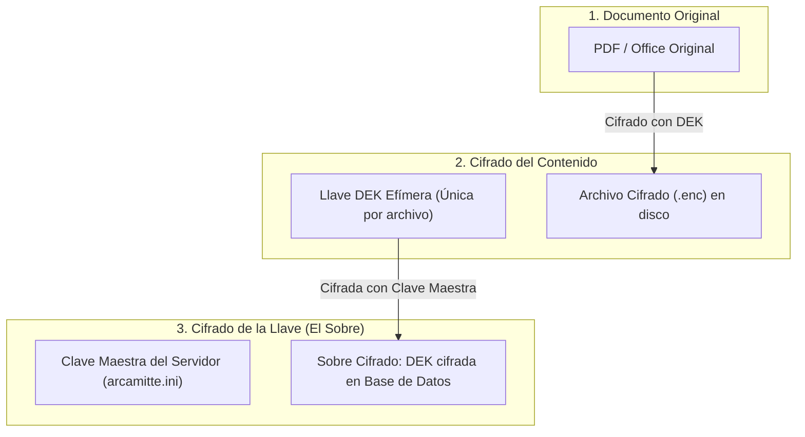
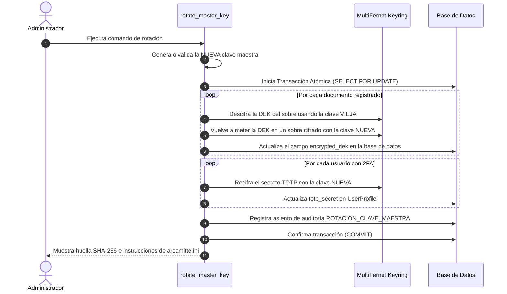
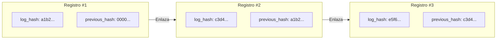

# Manual de Ciberseguridad y Guía de Configuración para Operadores (Arcamitte)

> **Destinatarios:** Operadores de sistemas, administradores de TI, auditores de cumplimiento y desarrolladores.  
> **Nivel técnico:** Explicado de forma didáctica, clara y con ejemplos prácticos para usuarios no criptógrafos.  
> **Estándares aplicados:** ENS Categoría ALTA, NIST SP 800-53 Rev. 5, NIST SP 800-57, NIST SP 800-63B, NIST SP 800-88 y OWASP Top 10.

---

## Índice
1. [El Gran Misterio: ¿Cómo Cifra Arcamitte? (Cifrado de Sobre)](file:///home/jorge/GitHubRepositories/Arcamitte/docs/SECURITY_CONFIG_GUIDE.md#1-el-gran-misterio-c%C3%B3mo-cifra-arcamitte-cifrado-de-sobre)
2. [La Rotación de Claves al Detalle: ¿Cómo Funciona y Cómo se Tratan las Viejas?](file:///home/jorge/GitHubRepositories/Arcamitte/docs/SECURITY_CONFIG_GUIDE.md#2-la-rotaci%C3%B3n-de-claves-al-detalle-c%C3%B3mo-funciona-y-c%C3%B3mo-se-tratan-las-viejas)
3. [Diccionario Completo de Configuraciones de Seguridad (`arcamitte.ini`)](file:///home/jorge/GitHubRepositories/Arcamitte/docs/SECURITY_CONFIG_GUIDE.md#3-diccionario-completo-de-configuraciones-de-seguridad-arcamitteini)
4. [Control de Sesiones: Anti-Secuestro e Inicio Único](file:///home/jorge/GitHubRepositories/Arcamitte/docs/SECURITY_CONFIG_GUIDE.md#4-control-de-sesiones-anti-secuestro-e-inicio-%C3%BAnico)
5. [Autenticación de Doble Factor (2FA / TOTP) y Códigos de Rescate](file:///home/jorge/GitHubRepositories/Arcamitte/docs/SECURITY_CONFIG_GUIDE.md#5-autenticaci%C3%B3n-de-doble-factor-2fa--totp-y-c%C3%B3digos-de-rescate)
6. [No Repudio e Integridad de Logs: La Cadena Criptográfica (*Hash Chaining*)](file:///home/jorge/GitHubRepositories/Arcamitte/docs/SECURITY_CONFIG_GUIDE.md#6-no-repudio-e-integridad-de-logs-la-cadena-criptogr%C3%A1fica-hash-chaining)
7. [Defensa Perimetral: Bloqueo de Cuentas y Baneo de IPs](file:///home/jorge/GitHubRepositories/Arcamitte/docs/SECURITY_CONFIG_GUIDE.md#7-defensa-perimetral-bloqueo-de-cuentas-y-baneo-de-ips)
8. [Conector SIEM / Webhooks en Tiempo Real](file:///home/jorge/GitHubRepositories/Arcamitte/docs/SECURITY_CONFIG_GUIDE.md#8-conector-siem--webhooks-en-tiempo-real)
9. [Destrucción Física de Archivos (NIST SP 800-88)](file:///home/jorge/GitHubRepositories/Arcamitte/docs/SECURITY_CONFIG_GUIDE.md#9-destrucci%C3%B3n-f%C3%ADsica-de-archivos-nist-sp-800-88)

---

## 1. El Gran Misterio: ¿Cómo Cifra Arcamitte? (Cifrado de Sobre)

Para entender cómo funciona la seguridad y por qué se rota una clave sin romper los archivos, primero debemos comprender el concepto de **Cifrado de Sobre (*Envelope Encryption*)**.

### La metáfora de la caja fuerte y el sobre cerrado

Imagina que una empresa guarda miles de documentos importantes:
- **Opción mala (cifrado simple con una sola clave):**  
  Cifras los 10.000 archivos con la contraseña del servidor. Si un día alguien sospecha que esa contraseña se ha filtrado y decides cambiarla, **tienes que descifrar y volver a cifrar los 10.000 archivos gigantes en el disco duro**. Si tienes 500 Gigabytes, el servidor tardaría horas o colapsaría, dejando la pasarela caída.
- **Opción Arcamitte (Cifrado de Sobre - Estándar Militar NIST SP 800-57):**  
  En Arcamitte existen **dos llaves distintas**:



1. **La Llave del Archivo (DEK - *Data Encryption Key*):**  
   Cada vez que subes un archivo, Arcamitte genera una clave matemática única de 256 bits al azar en la memoria RAM. El archivo se cifra con esa clave. **Esa clave nunca se reutiliza para ningún otro archivo**.
2. **La Clave Maestra del Servidor (KEK - *Key Encryption Key*):**  
   Esta es la clave que tú configuras en `arcamitte.ini` (`fernet_key`). Su único trabajo es **cifrar la pequeña llave DEK** (que solo mide unos pocos bytes) y meterla en un "sobre cerrado".
3. **El resultado:**  
   En el disco duro solo hay un archivo cifrado ininteligible (`.enc`). En la base de datos se guarda el "sobre" cerrado con la DEK dentro. **Nadie puede leer el archivo sin abrir el sobre con la Clave Maestra**.

---

## 2. La Rotación de Claves al Detalle: ¿Cómo Funciona y Cómo se Tratan las Viejas?

Esta es una de las dudas más habituales: **¿Qué pasa cuando roto la clave maestra? ¿Las claves viejas se tiran solas o qué tengo que hacer?**

### La respuesta corta:
> **Las claves maestras antiguas NO se descartan automáticamente**. Y está pensado así a propósito por seguridad absoluta: si se eliminaran solas antes de que confirmes que todo está en orden, o si tuvieras una copia de seguridad antigua, perderías los datos para siempre.

### ¿Cómo funciona el "Llavero" (*MultiFernet Keyring*)?
A partir de la versión 2.0, Arcamitte no maneja solo una clave en memoria, sino un **Llavero Criptográfico**:

```ini
[security]
# Llavero de claves maestras separadas por coma
fernet_keys = Clave_NUEVA_Primaria, Clave_VIEJA_Secundaria, Clave_ANTIGUA_Backup
```

El motor de Arcamitte sigue dos reglas inquebrantables:
1. **Para CIFRAR cosas nuevas:** El sistema SIEMPRE utiliza la **primera clave de la lista** (la clave primaria activa).
2. **Para DESCIFRAR cosas existentes:** El sistema toma el sobre cerrado y prueba primero con la clave primaria. Si ese sobre fue creado con una clave anterior, prueba con la segunda clave de la lista, luego con la tercera... **El usuario ni se entera; la descarga se produce con total normalidad**.

---

### ¿Qué hace exactamente el comando `python manage.py rotate_master_key`?

Cuando ejecutas el comando de rotación en el servidor:
```bash
poetry run python manage.py rotate_master_key --generate
```

Ocurre la siguiente secuencia atómica:



**Ventaja colosal:**  
Como los archivos grandes en disco están cifrados con su DEK y esa DEK no ha cambiado de contenido (solo se ha vuelto a meter en un sobre nuevo cerrado con la nueva llave maestra), el recifrado de 10.000 documentos tarda **menos de un segundo**, sin riesgo de corromper los binarios.

---

### Guía Práctica de Rotación: El Ciclo de Vida en 3 Pasos

Para rotar la clave sin ningún riesgo de pérdida de datos:

#### Paso 1: Ejecutar la rotación en base de datos
Ejecuta el comando en terminal:
```bash
poetry run python manage.py rotate_master_key --generate
```
El comando te devolverá una salida como esta:
```text
✔ Rotación completada con éxito:
  • Documentos recifrados : 142
  • Perfiles 2FA recifrados: 12
  • Huella de clave nueva : 8f9b4c2a1e0d3f...

ACCIONES REQUERIDAS:
1. Actualice 'arcamitte.ini' en la sección [security] con la directiva:

   [security]
   fernet_keys = NUEVA_CLAVE_GENERADA=,VIEJA_CLAVE_ANTERIOR=
```

#### Paso 2: Configurar la coexistencia en `arcamitte.ini`
Abre `arcamitte.ini` y edita la sección `[security]`:
```ini
[security]
# La nueva clave va PRIMERA (es la que cifra lo nuevo).
# La vieja clave va SEGUNDA (para asegurar que si quedó algo pendiente, se pueda leer).
fernet_keys = NUEVA_CLAVE_GENERADA=,VIEJA_CLAVE_ANTERIOR=
```
Reinicia el servicio de Arcamitte (o Gunicorn / Systemd). En este punto, el 100% de los datos activos ya usan la nueva clave.

#### Paso 3: Retiro seguro y custodia de la clave vieja
- **¿Puedo borrar ya la clave vieja de `arcamitte.ini`?**  
  Sí, porque el comando ya ha recifrado todos los registros de la base de datos actual.
- **¿Qué debo hacer con la clave vieja antes de quitarla?**  
  **Nunca la tires a la basura.** Cópiala y guárdala en el gestor de contraseñas seguro de tu entidad (KeePass, Bitwarden corporativo o HashiCorp Vault), etiquetándola con la fecha (ej. `Clave Maestra Arcamitte 2025-2026`).  
  *¿Por qué?* Si dentro de 8 meses tienes un desastre informático y tienes que restaurar un backup de la base de datos del año pasado, esa copia antigua de la base de datos tendrá los sobres cifrados con la clave vieja. Con tenerla apuntada en tu caja fuerte, podrás descifrarla cuando quieras.

---

### ¿Cuántas claves viejas conviene mantener en `arcamitte.ini`? (La Regla de las 3 Claves: Modelo N-2)

**Sí, mantener exactamente las 3 últimas claves en `arcamitte.ini` es la recomendación de oro de la industria (el modelo N-2 adoptado por AWS KMS, Google Cloud KMS y NIST SP 800-57):**

```ini
[security]
# Llavero recomendado: Clave Activa Actual + Las 2 Anteriores
fernet_keys = Clave_Actual_2026, Clave_Anterior_2025, Clave_Previa_2024
```

#### ¿Por qué 3 es el número perfecto?

1. **Cobertura total del ciclo de Backups y Recuperación ante Desastres (DR):**  
   Si rotas la clave una vez al año (o cada 6 meses), tener 3 claves en el llavero cubre entre **1 y 2 años de historial de copias de seguridad**. Si mañana tienes que restaurar una base de datos antigua de hace 10 meses para una auditoría o un peritaje judicial, Arcamitte arrancará y la podrá leer a la primera sin que nadie tenga que buscar llaves contrarreloj.
2. **Cero impacto en rendimiento:**  
   Probar 3 claves en memoria RAM mediante el motor Fernet tarda microsegundos imperceptibles (0.0001 segundos). No hay sobrecarga alguna para el servidor.
3. **Regla de purga según la Política de Retención de Backups:**  
   La regla para sacar una clave de `arcamitte.ini` es muy sencilla:  
   > *«Solo retira una clave vieja de `arcamitte.ini` cuando todos los backups que fueron cifrados con ella hayan sido legalmente destruidos o purgados por caducidad (ej. pasados 2 años).»*  
   Incluso al quitarla de `arcamitte.ini`, mantén siempre una copia en tu KeePass/Vault corporativo de contingencia.

---

---

## 3. Diccionario Completo de Configuraciones de Seguridad (`arcamitte.ini`)

A continuación se detalla cada parámetro de seguridad del archivo `arcamitte.ini`, su propósito, valor por defecto y qué ocurre ante un intento de ataque:

```ini
[security]
# ------------------------------------------------------------------------------
# 1. CLAVES CRIPTOGRÁFICAS MAESTRAS
# ------------------------------------------------------------------------------
# fernet_key: Clave maestra simétrica única (32 bytes base64 url-safe).
# Se utiliza como fallback si no se declara 'fernet_keys'.
fernet_key = cambiame-cambiame-cambiame-cambiame-cambiame=

# fernet_keys: Llavero MultiFernet para rotación de claves sin caída de servicio.
# Permite declarar múltiples claves separadas por coma. La primera es la activa.
fernet_keys = 

# ------------------------------------------------------------------------------
# 2. CONTROL DE ACCESO Y POLÍTICA DE CONTRASEÑAS (ENS ALTA / NIST SP 800-63B)
# ------------------------------------------------------------------------------
# user_max_failed_logins: Número máximo de intentos fallidos antes de bloquear la cuenta.
# Si un atacante prueba contraseñas al azar 5 veces, la cuenta se congela.
user_max_failed_logins = 5

# user_lockout_duration_minutes: Tiempo en minutos que la cuenta permanecerá bloqueada.
# Durante este periodo, ni el usuario legítimo ni el atacante pueden entrar (devuelve HTTP 429).
user_lockout_duration_minutes = 30

# password_min_length: Longitud mínima de contraseña obligatoria.
# El sistema exige además mayúsculas, minúsculas, números y símbolos.
password_min_length = 12

# password_history_limit: Cuántas contraseñas anteriores recuerda el sistema.
# Impide que el usuario alterne entre 'Pass1' y 'Pass2'. Debe usar una no vista en las últimas 5.
password_history_limit = 5

# password_expiration_days: Días de validez máxima de la contraseña antes de caducar.
# Al día 91, el usuario es interceptado y obligado a elegir una nueva clave antes de continuar.
password_expiration_days = 90

# ------------------------------------------------------------------------------
# 3. DEFENSA PERIMETRAL Y BANEO DE DIRECCIONES IP (Anti-DDoS / Anti-Brute Force)
# ------------------------------------------------------------------------------
# ip_ban_failed_attempts_threshold: Fallos acumulados desde una misma IP para ser expulsada.
# Si una IP genera 10 fallos (hacia cualquier cuenta) dentro de la ventana, es baneada.
ip_ban_failed_attempts_threshold = 10

# ip_ban_window_minutes: Ventana temporal en minutos para contar los fallos de una IP.
ip_ban_window_minutes = 10

# ip_ban_default_duration_hours: Duración del baneo de la IP en horas (0 = permanente).
# Durante este tiempo, cualquier petición de esa IP recibe un 403 Forbidden directo con 0 latencia.
ip_ban_default_duration_hours = 24

# ------------------------------------------------------------------------------
# 4. SEGURIDAD DE SESIÓN (Anti-Session Hijacking & Concurrencia)
# ------------------------------------------------------------------------------
# session_ip_binding: Si es true, vincula la sesión a la dirección IP inicial del operador.
# Si un atacante roba la cookie de sesión y la usa desde otra IP, es expulsado de inmediato.
session_ip_binding = true

# single_session_per_user: Si es true, solo permite UNA sesión activa simultánea por usuario.
# Si inicias sesión en el ordenador del despacho y luego abres en el portátil, la primera se cierra.
single_session_per_user = true

# ------------------------------------------------------------------------------
# 5. AUTENTICACIÓN MULTIFACTOR (2FA / TOTP)
# ------------------------------------------------------------------------------
# mfa_required_for_staff: Si es true, obliga a todo usuario de administración (staff o superusuario)
# a configurar y utilizar obligatoriamente un código de 6 dígitos en su móvil para entrar.
mfa_required_for_staff = false

# ------------------------------------------------------------------------------
# 6. CANAL DE ALERTAS Y TELEMETRÍA SIEM / WEBHOOKS
# ------------------------------------------------------------------------------
# security_alerts_email: Buzón del SOC / Administrador para avisos de incidentes.
# Recibe avisos si una IP es baneada o si una cuenta de usuario ha sido bloqueada.
security_alerts_email = admin@arcamitte.local

# siem_webhook_url: Endpoint HTTPS de monitorización (Splunk, Elastic, Sentinel, Slack, Teams).
# Envía paquetes JSON estructurados en tiempo real cada vez que ocurre un evento crítico.
siem_webhook_url = 

# siem_webhook_token: Token de autorización Bearer para el webhook del SIEM.
siem_webhook_token = 

# siem_webhook_events: Lista de eventos suscritos para notificación en tiempo real.
siem_webhook_events = ip_ban,user_lockout,log_tamper,audit_export,master_key_rotated

# ------------------------------------------------------------------------------
# 7. PARÁMETROS CRIPTOGRÁFICOS ADICIONALES
# ------------------------------------------------------------------------------
# max_file_size: Tamaño máximo permitido de archivo en bytes (52428800 = 50 MB).
max_file_size = 52428800

# timing_pbkdf2_iterations: Iteraciones de retardo para neutralizar ataques de temporización (CWE-208).
# Cuando alguien pide un archivo que no existe, el servidor calcula PBKDF2 para tardar lo mismo que si existiera.
timing_pbkdf2_iterations = 20000

# trust_x_forwarded_for: Solo poner a 'true' si Arcamitte está detrás de un proxy inverso confiable (Nginx/Traefik).
# Evita que un atacante falsee su IP mediante la cabecera X-Forwarded-For (CWE-348).
trust_x_forwarded_for = false
```

---

## 4. Control de Sesiones: Anti-Secuestro e Inicio Único

### A. Detección de Secuestro de Sesión (`session_ip_binding = true`)
- **El ataque:** Un atacante intercepta una cookie de sesión válida de un operador (vía malware en el cliente o sniffing de red local no cifrada).
- **Cómo lo neutraliza Arcamitte:** En el momento del inicio de sesión, el sistema anota la dirección IP de origen en la sesión cifrada (`_arca_client_ip`). El middleware intercepta cada petición HTTP subsecuente. Si la cookie es presentada desde una dirección IP diferente:
  1. Destruye la sesión de inmediato (`logout`).
  2. Registra un evento forense en auditoría: `SECUESTRO_SESION_DETECTADO`.
  3. Despacha una alerta de alta prioridad al SIEM.
  4. Redirige a la pantalla de login informando del incidente.

### B. Sesión Concurrente Única (`single_session_per_user = true`)
- **El ataque:** Credenciales compartidas indebidamente o un intruso conectado simultáneamente mientras el usuario legítimo trabaja.
- **Cómo lo neutraliza Arcamitte:** Cada vez que un usuario inicia sesión, se genera un identificador de sesión único (`current_session_key`) que se anota en su perfil. Si se produce un inicio de sesión posterior en otro dispositivo:
  1. La sesión antigua queda revocada en el acto.
  2. Al realizar la siguiente petición, el usuario del primer dispositivo ve cerrada su sesión con el mensaje: *"Su sesión ha expirado porque se ha iniciado sesión desde otro navegador o dispositivo"*.
  3. Queda constancia en los registros con la vicisitud `SESION_CONCURRENTE_TERMINADA`.

---

## 5. Autenticación de Doble Factor (2FA / TOTP) y Códigos de Rescate

### ¿Cómo sabe el servidor qué código sale en mi móvil si no están conectados por internet?
Arcamitte implementa el estándar **RFC 6238 (TOTP - *Time-Based One-Time Password*)**:
1. Durante la vinculación inicial, el servidor y tu aplicación móvil (Google Authenticator, Microsoft Authenticator, Aegis, FreeOTP) comparten un **secreto criptográfico de 160 bits** (mediante el código QR).
2. Ambos dispositivos conocen la hora universal UTC dividida en bloques de 30 segundos: `bloque = tiempo_actual / 30`.
3. Ambos calculan de forma idéntica: `HMAC-SHA1(secreto, bloque)`.
4. El resultado matemático genera los mismos 6 dígitos en tu pantalla y en el servidor. **No hace falta cobertura móvil ni conexión de datos**.
5. Arcamitte admite una ventana de deriva de $\pm 1$ intervalo (30 segundos antes o después) para compensar pequeños desfases en el reloj del teléfono.

### Códigos de Rescate de Emergencia (*Scratch Codes*)
- **¿Qué pasa si el operador pierde el móvil o se le rompe la pantalla?**  
  Al activar 2FA, Arcamitte entrega **8 códigos de rescate unívocos** de 8 caracteres (ej. `A7B2-9K4P`).
- **Seguridad de Grado Gubernamental:**  
  El servidor **NUNCA guarda los códigos de rescate en texto claro**. En la base de datos se guarda exclusivamente su resumen criptográfico **SHA-256**. Incluso si un atacante volcara la base de datos completa, no podría conocer los códigos de rescate.
- **Consumo único:**  
  Cada código de rescate solo sirve **una única vez**. Al usarse, se elimina de la base de datos y se anota la vicisitud en la auditoría inalterable.

---

## 6. No Repudio e Integridad de Logs: La Cadena Criptográfica (*Hash Chaining*)

El principio de **No Repudio (ENS op.exp.8 / eIDAS)** significa que nadie (ni siquiera el administrador de sistemas con acceso root a la base de datos) puede manipular o borrar un registro histórico sin ser descubierto.

### ¿Cómo funciona la cadena de bloques interna?

Cada asiento en la tabla de auditoría (`DocumentAccessLog`) incluye el hash del registro anterior:



El hash de cada fila se calcula combinando:
$$\text{Hash} = \text{SHA-256}(\text{ID} + \text{Fecha UTC} + \text{Acción} + \text{Actor} + \text{IP} + \text{Detalles} + \text{Hash Anterior})$$

- **¿Qué pasa si un intruso entra a la base de datos y altera un registro?**  
  Si alguien modifica el texto de un log antiguo o borra una fila, el hash recalculado ya no coincidirá con el siguiente eslabón.
- **Herramienta de Auditoría Integrada:**  
  El auditor puede pulsar en **"Verificar Integridad de Cadena"** en el panel o ejecutar la comprobación vía API. Si hay una alteración, el sistema señala exactamente en qué registro se produjo la ruptura y despacha una alerta al SIEM (`LOG_TAMPER`).

### Recibos Oficiales de Exportación (`AuditExportReceipt`)
Cuando se exporta un informe de auditoría en CSV:
1. El sistema sanitiza cada celda contra **CSV Injection (CWE-1236)** neutralizando fórmulas maliciosas (`=`, `+`, `-`, `@`).
2. Calcula la huella binaria **SHA-256 exacta** del archivo descargado.
3. Emite un **Recibo Inalterable con código de custodia** (ej. `ARCA-AUDIT-20261026-A1B2C3D4`).
4. Cualquier juez, auditor externo o perito judicial puede subir el archivo CSV a la herramienta de verificación de Arcamitte: si el archivo fue alterado aunque sea en una sola coma, el sistema certificará que el documento ha sido manipulado.

---

## 7. Defensa Perimetral: Bloqueo de Cuentas y Baneo de IPs

Arcamitte aplica una estrategia de defensa en capas (*Defense in Depth*) contra ataques automatizados de fuerza bruta y *Credential Stuffing*:

### Capa 1: Bloqueo de Cuenta de Usuario
- Si una cuenta acumula 5 intentos fallidos (`user_max_failed_logins = 5`), la cuenta se bloquea por 30 minutos.
- El servidor envía automáticamente un correo al usuario afectado avisándole del intento de acceso.
- El panel de administración permite a los administradores autorizados desbloquear al usuario manualmente si se confirma que fue un despiste legítimo.

### Capa 2: Baneo Perimetral de IP de Ultra-Baja Latencia
- Si una dirección IP sospechosa acumula 10 fallos en 10 minutos (incluso probando nombres de usuario distintos), entra automáticamente en la lista negra (`BannedIP`).
- **Aceleración en Caché (0 milisegundos de latencia):**  
  Para evitar que miles de peticiones de un ataque DoS sobrecarguen la base de datos relacional, el middleware `IPBanMiddleware` consulta el estado de la IP en la memoria RAM (`django.core.cache`). Las peticiones bloqueadas reciben un `403 Forbidden` instantáneo sin tocar la base de datos ni consumir CPU.

---

## 8. Conector SIEM / Webhooks en Tiempo Real

Arcamitte se integra de forma nativa con Centros de Operaciones de Seguridad (SOC) y herramientas SIEM como **Splunk, Elastic Security, Datadog o Azure Sentinel**.

### Formato de Telemetría JSON Normalizado
Cada vez que ocurre un evento de seguridad crítico, el conector despacha un payload asíncrono (sin retrasar la respuesta al usuario) vía HTTP POST con encabezado `Authorization: Bearer <token>`:

```json
{
  "timestamp": "2026-10-26T21:40:00.123456Z",
  "event": "IP_BAN",
  "actor": "Sistema",
  "client_ip": "198.51.100.22",
  "service": "arcamitte",
  "details": {
    "ip_address": "198.51.100.22",
    "reason": "Exceso de intentos fallidos de autenticación (10 fallos en ventana)",
    "duration_hours": 24,
    "banned_until": "2026-10-27T21:40:00Z"
  }
}
```

---

## 9. Destrucción Física de Archivos (NIST SP 800-88)

### ¿Por qué el borrado estándar de un sistema operativo es inseguro?
Cuando el comando `rm` de Linux o la papelera de Windows borran un archivo, **el contenido del archivo no se borra**. Simplemente se marca el espacio como "disponible" en la tabla de asignación. Mediante herramientas forenses sencillas (como Autopsy, Photorec o Foremost), cualquier persona que acceda al disco duro puede recuperar los documentos íntegros.

### El Protocolo de Destrucción de Arcamitte
Cuando un documento se consume (política *Burn-After-Read*) o vence su fecha de caducidad, el procedimiento [`shred_and_delete_file`](file:///home/jorge/GitHubRepositories/Arcamitte/arcamitte/services.py) ejecuta:
1. Averigua el tamaño exacto en bytes del archivo cifrado.
2. Abre el descriptor físico del archivo y **sobrescribe todos sus sectores con bytes aleatorios criptográficos** generados por `/dev/urandom` (`os.urandom`).
3. Invoca `os.fsync()` forzando a la controladora de disco físico y a la memoria caché a escribir los bytes aleatorios en las celdas magnéticas o chips de memoria flash.
4. Solo tras confirmar la sobrescritura física, desvincula el inodo del sistema de archivos (`unlink`).

Cualquier intento posterior de recuperación forense solo encontrará ruido blanco criptográfico irrecuperable.
